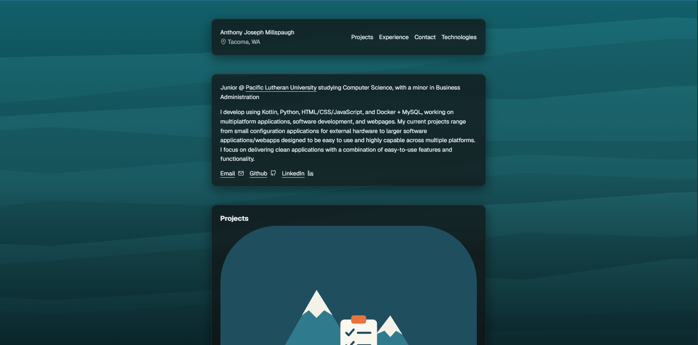

# Anthony Joseph Millspaugh | Portfolio
 
Personal portfolio website built with React and Vite, showcasing my projects, experience, and tech stack.
 
**Live site:** https://tonymillspaugh.com
 

 
## Features
 
- Animated project slider with directional slide and fade transitions
- Sections that fade in as you scroll to them
- Interactive, tinted cards over a layered, gradient background
- Sprite-sheet animated hiker walking across the footer
- Responsive layout for desktop and mobile
- Copy-to-clipboard email button and icon links
## Built With
 
- [React](https://react.dev/) and [Vite](https://vite.dev/)
- [motion](https://motion.dev/) for slide animations
- [react-icons](https://react-icons.github.io/react-icons/) for icons
- CSS
- GitHub Pages and Actions for hosting and deployment
 
The app lives in the `client` folder.
 
## Contact
 
- Email: amillspaugh@plu.edu
- LinkedIn: [Anthony Millspaugh](https://linkedin.com/in/anthony-millspaugh-240043341)
